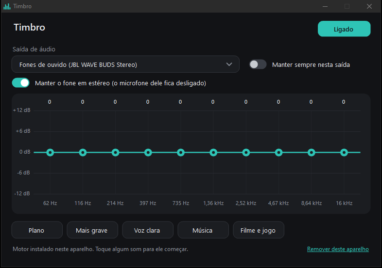

# Timbro

Equalizador simples para o Windows, com motor de som próprio. Fica no canto da barra de tarefas, guarda um ajuste para cada fone ou caixa e pode prender o som numa saída.

## Peças

- `timbro.cs`: a janela e o ícone da bandeja (C#, compila com o .NET que já vem no Windows).
- `motor\`: o motor de som (`timbro_apo.dll`, C++). É um APO, o tipo de plugin que o próprio Windows carrega no caminho do som de cada aparelho. Faz 10 faixas de equalização e baixa o volume na medida certa para não distorcer.
- `motor\teste_motor.exe`: testa os filtros e o motor fora do áudio do Windows.

## Baixar pronto

1. Desinstale o FxSound e o Equalizer APO, se estiverem no PC. Eles disputam o mesmo encaixe.
2. Baixe o `Timbro-<versão>.zip` em [Releases](https://github.com/caiquebmaso/timbro/releases/latest) e extraia numa pasta fixa (ex.: `C:\Programas\Timbro`). O `timbro.exe` e o `timbro_apo.dll` precisam ficar juntos.
3. Abra o `timbro.exe`. O Windows pode mostrar "O Windows protegeu o computador", porque o programa não tem assinatura digital paga: clique em "Mais informações" e "Executar assim mesmo".
4. Siga do passo 3 de "Instalar" abaixo.

## Instalar compilando

1. Desinstale o FxSound e o Equalizer APO, se estiverem no PC. Eles disputam o mesmo encaixe.
2. Rode `timbro.bat`. Na primeira vez ele compila o motor (precisa das Ferramentas de Build do Visual Studio com C++) e o Timbro.
3. Escolha o aparelho na lista e clique em "Instalar neste aparelho". O Windows pede administrador; o áudio para por uns segundos e volta.
4. Toque uma música. A linha de baixo mostra "Motor rodando".
5. Clique direito no ícone da bandeja e marque "Iniciar com o Windows".

## Usar

- Saída de áudio: escolher na lista já troca o som para esse aparelho e carrega o ajuste dele.
- "Manter sempre nesta saída": se o Windows trocar sozinho, o Timbro volta para ela.
- Bolinhas: arrastar muda a faixa; duplo clique zera; roda do mouse ajusta de 0,5 em 0,5 dB.
- Predefinições: Plano, Mais grave, Voz clara, Música, Filme e jogo.
- Ctrl+Alt+E liga e desliga o equalizador de qualquer lugar.
- Fechar a janela só esconde. Sair é pelo menu da bandeja. O equalizador continua com o Timbro fechado.

## Se o som sumir

Rode `emergencia.bat` (ou, no menu da bandeja, "Remover o motor de todos os aparelhos"). Ele devolve cada aparelho como era e tira o motor. Se o som não voltar, reinicie o PC.

## O que a instalação muda no Windows

- Copia o motor para `C:\Program Files\Timbro\timbro_apo.dll` e registra ele.
- Liga `DisableProtectedAudioDG` em `HKLM\SOFTWARE\Microsoft\Windows\CurrentVersion\Audio`. O Windows só carrega APO sem assinatura da Microsoft assim (o Equalizer APO faz o mesmo).
- No aparelho escolhido, põe o motor como efeito de ponta (EFX) em `MMDevices\Audio\Render\{aparelho}\FxProperties`. Essas chaves são do sistema: o Timbro assume a posse delas para gravar.
- Guarda tudo o que havia antes (valores e permissões) em `HKLM\SOFTWARE\TimbroBackup`. Remover devolve daí.
- Ajustes: o Timbro grava em `HKLM\SOFTWARE\Timbro` (Ligado e Perfis) e o motor lê na hora, sem reiniciar o áudio. O motor anota em `Timbro\Estado` quando está rodando.
- Registro do que foi feito: `%LOCALAPPDATA%\Timbro\motor.log`.

## Diagnóstico

- `timbro.exe --listar saida.txt`: saídas, onde o motor está instalado e o estado dele.
- `timbro.exe --predef "Mais grave"`: aplica uma predefinição na saída atual e sai.
- `motor\compilar.bat` e depois `motor\bin\teste_motor.exe motor\bin\timbro_apo.dll`: testes do motor.
